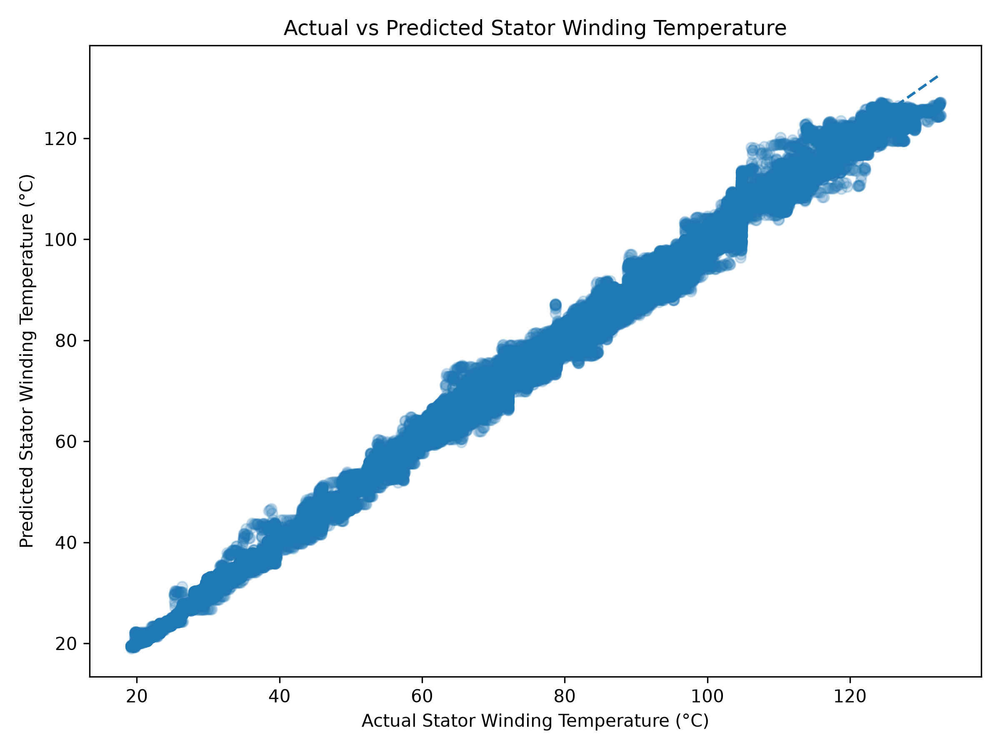
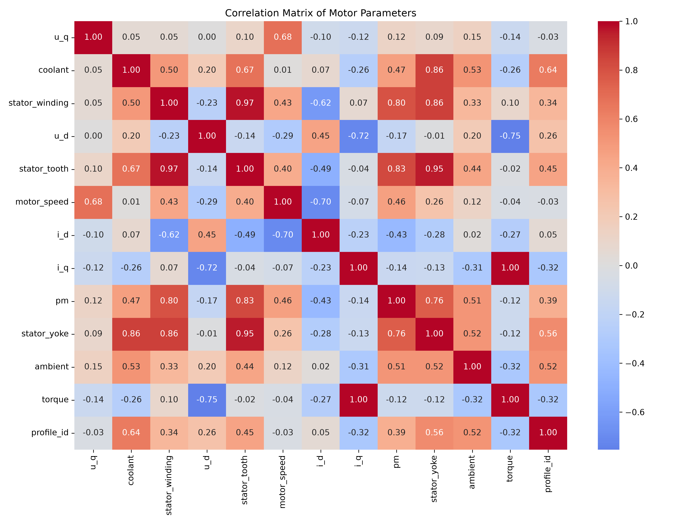
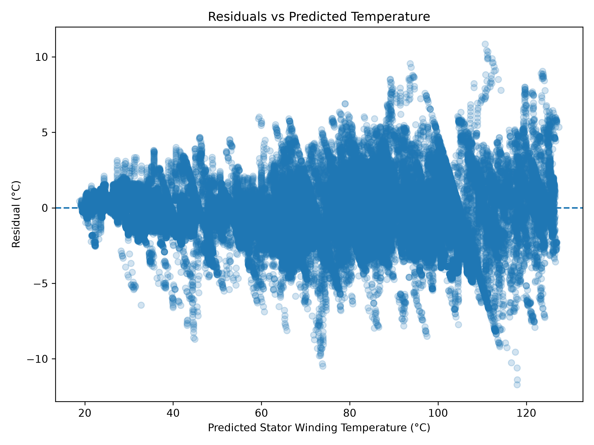
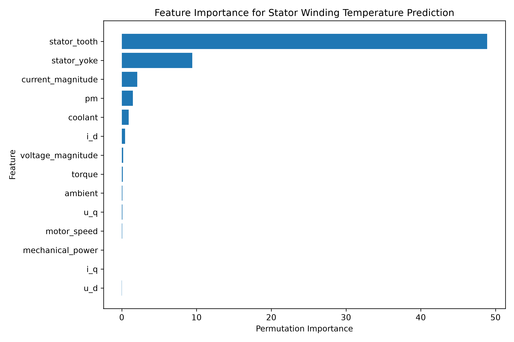

# Electric Motor Temperature Prediction

<p align="center">
  
  
  
  
  
  
</p>

An end-to-end machine learning pipeline that predicts **stator winding temperature** in a permanent-magnet synchronous motor (PMSM) from its operating and thermal sensor readings, built with leakage-aware, profile-based data splitting.

---

## Table of Contents

| Section | Description |
| :--- | :--- |
| [Overview](#overview) | Problem statement and motivation |
| [Results at a Glance](#results-at-a-glance) | Headline performance figures |
| [Project Structure](#project-structure) | Repository layout |
| [Dataset](#dataset) | Source, schema, and data quality |
| [The Pipeline](#the-pipeline) | Stage-by-stage walkthrough |
| [Evaluation Metrics](#evaluation-metrics) | Rationale for MAE, RMSE and R-squared |
| [Model Comparison](#model-comparison) | Validation leaderboard |
| [Hyperparameter Tuning](#hyperparameter-tuning) | Search space and selected parameters |
| [Final Test Evaluation](#final-test-evaluation) | Performance on unseen profiles |
| [Model Diagnostics](#model-diagnostics) | Residual and feature-importance analysis |
| [Using the Trained Model](#using-the-trained-model) | Inference example |
| [Setup and Reproducibility](#setup-and-reproducibility) | Environment and execution order |
| [Technology Stack](#technology-stack) | Libraries and tooling |
| [Key Design Decisions](#key-design-decisions) | Rationale behind the methodology |
| [Known Limitations](#known-limitations) | Documented caveats |
| [Future Improvements](#future-improvements) | Development roadmap |

---

## Overview

### Problem Statement

The stator winding is the hottest and most thermally vulnerable component of an electric motor. Measuring its temperature directly in a production vehicle requires sensors that are expensive, fragile, and difficult to position. Estimating it from cheaper, already-available measurements is therefore a practical engineering objective.

**Goal.** Predict `stator_winding` temperature from the motor's electrical, mechanical, and thermal sensor readings.

### Motivation

A reliable temperature estimate supports:

- **Condition monitoring** — early detection of abnormal thermal behaviour
- **Thermal management** — cooling strategy driven by a live estimate
- **Performance headroom** — safe operation closer to real thermal limits
- **Component protection** — prevention of insulation degradation and failure

### Approach

A complete, leakage-aware data science workflow:

```text
Data Cleaning -> EDA -> Feature Engineering -> Profile-Based Splitting
     -> Baseline -> Model Comparison -> Hyperparameter Tuning
     -> Final Test -> Error Analysis -> Feature Importance -> Model Saving
```

---

## Results at a Glance

The final tuned model, evaluated on **7 motor profiles never seen during training**:

| Metric | Result | Interpretation |
| :--- | :---: | :--- |
| **MAE** | **1.145 °C** | Average prediction is off by roughly one degree |
| **RMSE** | **1.644 °C** | Large errors remain small and infrequent |
| **R-squared** | **0.99696** | Explains approximately 99.7% of temperature variation |
| Baseline MAE | 25.905 °C | The model is roughly **23x more accurate** than predicting the mean |

<p align="center">
  
</p>

---

## Project Structure

```text
motor/
|
+-- data/
|   +-- raw/                            # Git-ignored; see Dataset section
|       +-- measures_v2.csv
|
+-- notebooks/
|   +-- 01_data_cleaning.ipynb          # Loading, integrity checks, profiling
|   +-- 02_eda.ipynb                    # Distributions, relationships, correlations
|   +-- 03_feature_engineering.ipynb    # Physics-based features and group split
|   +-- 04_model_training.ipynb         # Training, tuning, evaluation, export
|
+-- graphs/
|   +-- correlation_heatmap.png             # Feature correlation matrix
|   +-- profile_observation_counts.png      # Observation count per motor profile
|   +-- ambient_vs_stator_winding.png       # -----+
|   +-- coolant_vs_stator_winding.png       #      |
|   +-- stator_tooth_vs_stator_winding.png  #      |
|   +-- stator_yoke_vs_stator_winding.png   #      |  EDA relationship
|   +-- pm_vs_stator_winding.png            #      +- plots against the
|   +-- motor_speed_vs_stator_winding.png   #      |  target variable
|   +-- torque_vs_stator_winding.png        #      |
|   +-- i_d_vs_stator_winding.png           #      |
|   +-- i_q_vs_stator_winding.png           # -----+
|   +-- actual_vs_predicted.png             # Final model fit quality
|   +-- residual_analysis.png               # Error structure
|   +-- feature_importance.png              # Permutation importance
|
+-- models/
|   +-- final_temperature_model.pkl     # Tuned HistGradientBoosting (11 features)
|
+-- .gitignore
+-- readme.md
+-- requirements.txt
```

---

## Dataset

### Source

This project uses the **Electric Motor Temperature** dataset collected by the LEA department at **Paderborn University**, published on [Kaggle](https://www.kaggle.com/datasets/wkirgsn/electric-motor-temperature). It records sensor measurements from a PMSM on a test bench, sampled at **2 Hz**.

> **Note.** The dataset is not included in this repository, as `data/raw/` is git-ignored. Download `measures_v2.csv` from the link above and place it at `data/raw/measures_v2.csv` before running the notebooks.

### Scale

| Property | Value |
| :--- | ---: |
| Observations | **1,330,816** |
| Columns | **13** |
| Motor profiles (measurement sessions) | **69** |
| Sampling rate | 2 Hz |

### Schema

| Column | Category | Description |
| :--- | :--- | :--- |
| `u_q` | Electrical | Voltage, q-axis component |
| `u_d` | Electrical | Voltage, d-axis component |
| `i_q` | Electrical | Current, q-axis component |
| `i_d` | Electrical | Current, d-axis component |
| `motor_speed` | Mechanical | Rotational speed |
| `torque` | Mechanical | Torque induced by current |
| `ambient` | Thermal | Ambient temperature |
| `coolant` | Thermal | Coolant outflow temperature |
| `stator_yoke` | Thermal | Stator yoke temperature |
| `stator_tooth` | Thermal | Stator tooth temperature |
| `pm` | Thermal | Permanent magnet (rotor) temperature |
| `stator_winding` | **Target** | **Stator winding temperature** |
| `profile_id` | Grouping key | Measurement session identifier |

`profile_id` is **excluded from the predictive features**. It identifies a session rather than describing an operating condition, and including it would allow the model to memorise profile-specific behaviour. It is used exclusively as the grouping variable for splitting.

### Data Quality

Verified in [01_data_cleaning.ipynb](notebooks/01_data_cleaning.ipynb):

| Check | Result |
| :--- | :--- |
| Missing values | **0** |
| Duplicate rows | **0** |
| Unique profiles | **69** |
| Infinite values (engineered features) | **0** |

Observation counts vary considerably between profiles, as some sessions are substantially longer than others. This imbalance is visualised in `graphs/profile_observation_counts.png` and is precisely why the splitting strategy described below matters.

---

## The Pipeline

### 1. Data Cleaning

Notebook: [`notebooks/01_data_cleaning.ipynb`](notebooks/01_data_cleaning.ipynb)

Establishes that the raw measurements are trustworthy before any modelling begins:

- Load the raw CSV and inspect shape, columns and data types
- Check for missing values and duplicate observations
- Review descriptive statistics for physically implausible values
- Examine the motor-profile structure and observation distribution

**Outcome.** A clean dataset of approximately 1.33 million rows across 69 profiles, requiring no imputation or row removal.

---

### 2. Exploratory Data Analysis

Notebook: [`notebooks/02_eda.ipynb`](notebooks/02_eda.ipynb)

Explores how each motor variable relates to stator winding temperature. A dedicated scatter plot was generated for every major predictor, alongside a full correlation matrix.

<p align="center">
  
</p>

#### Key Findings

| Observation | Implication |
| :--- | :--- |
| `stator_tooth` and `stator_yoke` correlate very strongly with the target | Adjacent stator components share a thermal path, so these dominate prediction |
| `pm` and `coolant` show strong thermal relationships | Rotor heat and cooling capacity both shape winding temperature |
| Electrical and mechanical variables show weaker, nonlinear relationships | Motivates evaluating tree-based models, not only linear ones |
| Temperature depends on several interacting parameters simultaneously | No single sensor is sufficient in isolation |

---

### 3. Feature Engineering and Data Splitting

Notebook: [`notebooks/03_feature_engineering.ipynb`](notebooks/03_feature_engineering.ipynb)

#### Physics-Based Features

Three derived features encode motor physics that the raw d/q-axis components express only indirectly:

| Feature | Formula | Rationale |
| :--- | :--- | :--- |
| `current_magnitude` | `sqrt(i_d^2 + i_q^2)` | Total current magnitude, the direct driver of **copper (I2R) losses** |
| `voltage_magnitude` | `sqrt(u_d^2 + u_q^2)` | Total voltage magnitude, reflecting overall electrical loading |
| `mechanical_power` | `torque * (2 * pi * motor_speed / 60)` | Shaft power in watts, linking load to heat generation |

All three were verified to contain no missing and no infinite values.

#### Profile-Based Splitting

Observations within a single motor profile are **sequential and highly autocorrelated**. Two consecutive samples, taken half a second apart, are nearly identical.

**A random row split would leak information.** Near-duplicate rows from the same session would land in both the training and test sets, producing a score that measures memorisation rather than generalisation.

**The solution** is to split by **whole profiles** using `GroupShuffleSplit`, so that every measurement session belongs to exactly one set. The test set then represents genuinely unseen motors.

Split produced in this notebook (70/30, with the remainder halved):

| Set | Profiles | Rows | Share |
| :--- | ---: | ---: | ---: |
| Training | 48 | 879,860 | 66.1% |
| Validation | 10 | 211,545 | 15.9% |
| Test | 11 | 239,411 | 18.0% |

Overlap between all three profile groups was explicitly verified to be empty.

---

### 4. Model Training

Notebook: [`notebooks/04_model_training.ipynb`](notebooks/04_model_training.ipynb)

> **Note on scope.** This notebook is self-contained: it re-loads the raw CSV and trains on the **11 raw sensor features**, using its own 80/20 profile split (**55 training, 7 validation, 7 test** profiles, corresponding to 1,026,423 / 178,633 / 125,760 rows). The engineered features from notebook 03 are therefore **not** part of the exported model. See [Known Limitations](#known-limitations).

The task is framed as **supervised regression**: motor sensor readings in, a continuous temperature out.

#### Models Evaluated

| Model | Configuration | Purpose |
| :--- | :--- | :--- |
| **DummyRegressor** | `strategy="mean"` | Baseline establishing whether the features carry any signal |
| **Linear Regression** | Default | Tests how far a purely linear relationship goes |
| **Ridge Regression** | `alpha=1.0` | L2 regularisation for stability under correlated inputs |
| **Random Forest** | `n_estimators=100`, `max_depth=15`, `min_samples_leaf=5` | Captures nonlinearity and feature interactions |
| **HistGradientBoosting** | `max_iter=200`, `learning_rate=0.08`, `max_leaf_nodes=31`, `l2_regularization=1.0` | Sequential boosting designed for large tabular data |

Random Forest was trained on a **200,000-row random subsample** of the training set to keep training time manageable; it was already the slowest model by a wide margin.

---

## Evaluation Metrics

The target is a **continuous temperature**, making this a regression problem. Classification metrics such as accuracy, precision, recall and F1 do not apply, as there are no classes to classify correctly, only distances to minimise.

### MAE — Mean Absolute Error

*Lower is better.*

```text
MAE = mean(|actual - predicted|)
```

The average absolute error, expressed in degrees Celsius. This is the most directly interpretable metric here: an MAE of 1.145 means the typical prediction is off by approximately 1.1 degrees.

### RMSE — Root Mean Squared Error

*Lower is better.*

```text
RMSE = sqrt(mean((actual - predicted)^2))
```

Squaring before averaging causes RMSE to **penalise large errors disproportionately**. An RMSE close to the MAE indicates that errors are consistent rather than dominated by occasional severe misses.

### R-squared — Coefficient of Determination

*Higher is better.*

The proportion of variance in the target explained by the model. A value of `1.0` is a perfect fit and `0.0` matches a mean-only prediction. **Negative values are worse than the mean**, which is exactly what the baseline achieves.

---

## Model Comparison

Validation performance, sorted by RMSE:

| Rank | Model | MAE (°C) | RMSE (°C) | R-squared | Train Time |
| :---: | :--- | ---: | ---: | ---: | ---: |
| 1 | **Ridge Regression** | 1.3226 | **1.7722** | **0.996595** | 0.42 s |
| 2 | Linear Regression | 1.3226 | 1.7722 | 0.996595 | 1.35 s |
| 3 | HistGradientBoosting | **1.2688** | 1.8167 | 0.996421 | 42.04 s |
| 4 | Random Forest | 1.4375 | 2.1106 | 0.995170 | 168.43 s |
| — | *Baseline (mean)* | *25.9055* | *30.6057* | *-0.015676* | *0.01 s* |

### Interpretation

- **Every trained model substantially outperforms the baseline.** The features carry a large amount of predictive signal: a mean-only prediction is off by approximately 26 °C, while the trained models achieve approximately 1.3 °C.
- **The baseline's R-squared is negative.** Because the split is by profile, the validation profiles have a different mean temperature than the training profiles, so the training mean is a slightly worse predictor than the validation set's own mean. This is a characteristic signature of an honest group split.
- **Linear and Ridge are effectively identical.** With `alpha=1.0` applied to more than one million rows, the L2 penalty is negligible and the two converge to the same solution.
- **The metrics disagree, which is itself informative.** HistGradientBoosting wins on MAE (best typical error) while the linear models win on RMSE (fewer large errors). Boosting fits the bulk of the distribution more tightly but produces a small number of larger misses.

**Selection.** HistGradientBoosting was carried forward for tuning. It achieved the best MAE, models nonlinear interactions that the linear models structurally cannot, and trains roughly four times faster than Random Forest while scoring better.

---

## Hyperparameter Tuning

`RandomizedSearchCV` over 8 candidates with 3-fold cross-validation, totalling **24 fits**, scored on negative RMSE.

<table>
<tr><th align="left">Search Space</th><th align="left">Selected Parameters</th></tr>
<tr valign="top"><td>

| Parameter | Values |
| :--- | :--- |
| `learning_rate` | 0.03, 0.05, 0.1 |
| `max_iter` | 100, 200, 300 |
| `max_leaf_nodes` | 15, 31, 63 |
| `min_samples_leaf` | 20, 50, 100 |
| `l2_regularization` | 0.0, 0.1, 1.0 |

</td><td>

| Parameter | Selected |
| :--- | :--- |
| `learning_rate` | **0.1** |
| `max_iter` | **300** |
| `max_leaf_nodes` | **31** |
| `min_samples_leaf` | **50** |
| `l2_regularization` | **1.0** |

</td></tr>
</table>

### Tuned versus Original

| Model | MAE (°C) | RMSE (°C) | R-squared |
| :--- | ---: | ---: | ---: |
| Original HistGradientBoosting | **1.2688** | 1.8167 | 0.996421 |
| Tuned HistGradientBoosting | 1.2769 | **1.8000** | **0.996487** |

**Assessment.** Tuning produced a marginal and mixed improvement: RMSE and R-squared improved slightly, while MAE deteriorated slightly. This is the expected outcome when a model already operates near the information ceiling of its features. The tuned model was adopted because RMSE was the search's optimisation target, but the margin is small enough that retaining the untuned configuration would have been equally defensible.

The **test set remained untouched** throughout model selection and tuning.

---

## Final Test Evaluation

The tuned model was evaluated once, on 7 motor profiles held out from every prior stage:

| Metric | Validation | Test | Change |
| :--- | ---: | ---: | :--- |
| MAE | 1.2769 °C | **1.1449 °C** | Improved |
| RMSE | 1.8000 °C | **1.6449 °C** | Improved |
| R-squared | 0.996487 | **0.996936** | Improved |

**Test performance slightly exceeds validation performance.** This is a reassuring result, indicating that the model is not overfitted to the validation profiles and that the 7 test profiles are marginally easier. An R-squared of approximately 0.997 means the model accounts for nearly all observed variation in stator winding temperature **on motors it has never encountered**.

---

## Model Diagnostics

### Actual versus Predicted

<p align="center">
  
</p>

Predictions are plotted against measured temperatures with the diagonal `actual = predicted` reference line. Tight clustering around the diagonal provides visual confirmation of the numeric metrics.

### Residual Analysis

Residual is defined as **actual minus predicted**. Ideally these scatter randomly around zero with no visible structure.

<p align="center">
  
</p>

| Statistic | Value |
| :--- | ---: |
| Mean residual | **-0.4712 °C** |
| Standard deviation | 1.5760 °C |
| Minimum | -12.0062 °C |
| Maximum | +10.6804 °C |

**Finding.** The mean residual is **-0.47 °C** rather than approximately zero, indicating that the model **slightly over-predicts** temperature on the test profiles — a small systematic bias. Worst-case errors reach roughly plus or minus 12 °C. Neither observation is visible in MAE, RMSE or R-squared, which is precisely why residual analysis is worth performing. For a safety-critical thermal application the direction of the bias is relevant: over-prediction is the conservative failure mode, but it remains a genuine offset rather than noise.

### Feature Importance

Permutation importance on the validation set, using 5 repeats and scored on negative RMSE:

<p align="center">
  
</p>

| Rank | Feature | Importance | Category |
| :---: | :--- | ---: | :--- |
| 1 | **`stator_tooth`** | **49.3563** | Thermal |
| 2 | **`stator_yoke`** | **8.7694** | Thermal |
| 3 | `pm` | 1.4171 | Thermal |
| 4 | `i_d` | 1.1704 | Electrical |
| 5 | `coolant` | 1.0199 | Thermal |
| 6 | `torque` | 0.7425 | Mechanical |
| 7 | `u_q` | 0.5991 | Electrical |
| 8 | `ambient` | 0.1138 | Thermal |
| 9 | `i_q` | 0.0579 | Electrical |
| 10 | `motor_speed` | 0.0274 | Mechanical |
| 11 | `u_d` | 0.0219 | Electrical |

**`stator_tooth` dominates overwhelmingly**, carrying roughly 5.6 times the importance of the next feature and approximately 35 times the remainder combined. This is physically coherent, as the stator tooth sits directly adjacent to the winding and shares its thermal path, making it a near-proxy for the target.

**An important qualification.** The model's accuracy depends heavily on another temperature sensor located within the same stator. This is legitimate for **virtual sensing**, where replacing a fragile winding sensor with a robust tooth sensor is a genuinely useful engineering outcome. It is **not** a solution for predicting winding temperature from electrical quantities alone, which is a harder problem requiring the stator thermal features to be dropped.

---

## Using the Trained Model

The tuned model is saved at [`models/final_temperature_model.pkl`](models/final_temperature_model.pkl) and can be loaded without retraining.

> **Important.** The saved model expects exactly 11 features, in the order given below. The engineered features from notebook 03 are not part of it.

```python
import joblib
import pandas as pd

# Load the trained model
model = joblib.load("models/final_temperature_model.pkl")

# Features must match the training schema exactly, in this order
FEATURES = [
    "u_q", "coolant", "u_d", "stator_tooth", "motor_speed",
    "i_d", "i_q", "pm", "stator_yoke", "ambient", "torque",
]

# Example: a single operating point
sample = pd.DataFrame([{
    "u_q":          -0.45,
    "coolant":      18.80,
    "u_d":          -0.35,
    "stator_tooth": 18.29,
    "motor_speed":   0.00,
    "i_d":          -0.005,
    "i_q":           0.002,
    "pm":           24.55,
    "stator_yoke":  18.32,
    "ambient":      19.85,
    "torque":        0.19,
}])[FEATURES]

prediction = model.predict(sample)
print(f"Predicted stator winding temperature: {prediction[0]:.2f} °C")
```

Batch prediction:

```python
df = pd.read_csv("your_measurements.csv")
df["predicted_stator_winding"] = model.predict(df[FEATURES])
```

<details>
<summary><b>Model specification</b></summary>

<br>

| Property | Value |
| :--- | :--- |
| Estimator | `HistGradientBoostingRegressor` |
| Input features | 11 |
| `learning_rate` | 0.1 |
| `max_iter` | 300 |
| `max_leaf_nodes` | 31 |
| `min_samples_leaf` | 50 |
| `l2_regularization` | 1.0 |
| `random_state` | 42 |
| Serialised with | `joblib` |
| Trained on scikit-learn | 1.9.0 |

Loading a pickled estimator with a different scikit-learn version may raise compatibility warnings.

</details>

---

## Setup and Reproducibility

### 1. Clone the repository

```bash
git clone <repository-url>
cd motor
```

### 2. Create and activate a virtual environment

<table>
<tr><th align="left">Windows</th><th align="left">macOS and Linux</th></tr>
<tr valign="top"><td>

```bash
python -m venv .venv
.venv\Scripts\activate
```

</td><td>

```bash
python3 -m venv .venv
source .venv/bin/activate
```

</td></tr>
</table>

### 3. Install dependencies

```bash
pip install -r requirements.txt
```

### 4. Download the dataset

Obtain `measures_v2.csv` from [Kaggle](https://www.kaggle.com/datasets/wkirgsn/electric-motor-temperature) and place it at:

```text
data/raw/measures_v2.csv
```

### 5. Launch Jupyter

```bash
jupyter notebook
```

Alternatively, open the folder in VS Code and select `.venv` as the Jupyter kernel.

### 6. Run the notebooks in order

```text
01_data_cleaning.ipynb -> 02_eda.ipynb -> 03_feature_engineering.ipynb -> 04_model_training.ipynb
```

**Expected runtime.** Notebook 04 takes approximately **10 to 15 minutes** on a typical laptop. Random Forest (approximately 168 seconds) and the 24-fit hyperparameter search dominate that time. All random operations are seeded with `random_state=42` for reproducibility.

---

## Technology Stack

| Tool | Version | Role |
| :--- | :--- | :--- |
| **Python** | 3.11 | Core language |
| **pandas** | 3.0 | Data loading and manipulation |
| **NumPy** | 2.4 | Numerical computation and feature mathematics |
| **Matplotlib** | 3.11 | Plotting |
| **Seaborn** | 0.13 | Statistical visualisation |
| **scikit-learn** | 1.9 | Modelling, tuning, evaluation, interpretation |
| **joblib** | 1.6 | Model persistence |
| **Jupyter** | — | Interactive analysis |
| **Git / GitHub** | — | Version control |

---

## Key Design Decisions

<details open>
<summary><b>Why profile-based splitting instead of a random split?</b></summary>

<br>

Measurements within a profile are sequential and sampled at 2 Hz, making consecutive rows nearly identical. A random row split would place near-duplicates in both the training and test sets, and the resulting score would reflect **memorisation rather than generalisation** — most likely an R-squared above 0.999 that collapses on a genuinely new motor.

Applying `GroupShuffleSplit` to `profile_id` guarantees that each session belongs to exactly one set, so the test score answers the question that actually matters: how well does this perform on a motor it has never seen?

</details>

<details>
<summary><b>Why regression metrics instead of accuracy, precision or F1?</b></summary>

<br>

The target is a continuous physical quantity, such as `87.42 °C`, `91.17 °C` or `103.54 °C`. These are measurements on a continuous scale rather than class labels, so there is no notion of a correct prediction to count. What matters is how far off each prediction is, which is exactly what MAE, RMSE and R-squared measure. Classification metrics are undefined in this context.

</details>

<details>
<summary><b>Why include a dummy baseline at all?</b></summary>

<br>

Without a reference point, a figure such as "R-squared = 0.996" is unanchored. The `DummyRegressor` predicts the training mean and answers a prerequisite question: do these features contain usable signal?

The baseline achieves an MAE of 25.9 °C and a negative R-squared, while trained models reach approximately 1.3 °C. That improvement of roughly 20 times confirms the features are genuinely informative rather than the metrics being flattering.

</details>

<details>
<summary><b>Why compare four different model families?</b></summary>

<br>

Each captures a different kind of structure:

- **Linear and Ridge** establish how much is explainable by linear relationships alone, setting a strong bar at negligible cost
- **Random Forest** uses parallel trees, is robust to outliers, and captures interactions
- **HistGradientBoosting** applies sequential error correction and is designed for large tabular data

The comparison proved to be the most informative part of the project: the linear models are competitive with the boosted model, revealing that the target is largely a linear function of the stator thermal sensors. That finding would have been invisible had only one model been trained.

</details>

<details>
<summary><b>Why engineer physics-based features?</b></summary>

<br>

The features `current_magnitude`, `voltage_magnitude` and `mechanical_power` encode known motor physics. Resistive heating scales with total current magnitude rather than with `i_d` and `i_q` individually, so providing these directly saves the model from having to rediscover the relationship from raw d/q components.

</details>

---

## Known Limitations

These are documented openly, as they shape how the results should be interpreted.

| # | Limitation | Detail |
| :---: | :--- | :--- |
| 1 | **Engineered features are unused by the final model** | Notebook 03 builds `current_magnitude`, `voltage_magnitude` and `mechanical_power`, but notebook 04 re-loads the raw CSV and trains on the 11 raw sensors. The exported model accepts **11 features**. Wiring notebook 03's output into training is the clearest next improvement. |
| 2 | **The two notebooks use different splits** | Notebook 03 splits 70/30, yielding **48/10/11** profiles; notebook 04 splits 80/20, yielding **55/7/7** profiles. All reported model metrics originate from notebook 04's split. Consolidating onto a single split would make the pipeline internally consistent. |
| 3 | **Tuning cross-validation does not respect profile groups** | `RandomizedSearchCV` uses plain 3-fold cross-validation, so folds may mix profiles — the precise leakage the top-level split was designed to avoid. `GroupKFold` would make the search internally consistent. Final test metrics are unaffected, as the test profiles were never involved. |
| 4 | **Accuracy depends heavily on a co-located sensor** | `stator_tooth` carries approximately 49 of roughly 63 total importance. The model is best understood as a **virtual winding sensor** given a tooth sensor, rather than as a prediction from electrical quantities alone. |
| 5 | **A small systematic bias is present** | The mean test residual is **-0.47 °C**, indicating slight over-prediction rather than an unbiased estimate. |
| 6 | **Single train/test draw** | Results derive from one split with `random_state=42`. Repeated group cross-validation would yield confidence intervals rather than point estimates. |
| 7 | **No temporal validation** | The data is time-series in nature, but the model treats each row independently. Sequence-aware validation would better reflect deployment conditions. |
| 8 | **Test-bench data only** | All measurements originate from a controlled bench setup and may not transfer directly to on-road operating conditions. |

---

## Future Improvements

**Modelling**

- [ ] Train the final model on the engineered features and quantify whether they add measurable value
- [ ] Replace cross-validation in tuning with `GroupKFold` so the search respects profile boundaries
- [ ] Correct the -0.47 °C residual bias through calibration or an adjusted objective
- [ ] Train a variant excluding stator thermal sensors, a harder and more broadly useful problem
- [ ] Add prediction uncertainty through quantile regression or conformal prediction
- [ ] Explore sequence models such as LSTM or temporal CNN that exploit time structure
- [ ] Evaluate XGBoost, LightGBM and CatBoost against the current best model

**Validation**

- [ ] Repeated group cross-validation for confidence intervals
- [ ] Per-profile error breakdown to identify which motor conditions are hardest
- [ ] Time-series-aware validation reflecting real deployment

**Deployment**

- [ ] REST API for model inference
- [ ] Real-time dashboard for live motor monitoring
- [ ] Latency benchmarking for embedded and real-time use
- [ ] Packaging as a lightweight prediction service

---

## Author

Developed as an end-to-end machine learning project covering data preparation, exploratory analysis, leakage-aware splitting, regression modelling, hyperparameter tuning, evaluation, interpretation and model persistence.
